<p align="center">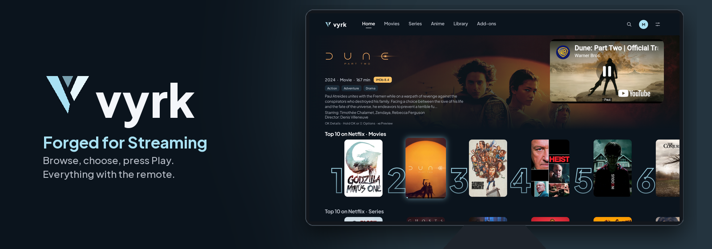</p>

<p align="center">
  <a href="https://github.com/MYKLHARU/vyrk-tv/actions/workflows/ci.yml"></a>
  
  
  
  
  
</p>

# VYRK

**Browse, choose, press Play. Everything with the remote.**

VYRK is a free, open-source Android TV client for Stremio add-ons. Sign in to your Stremio account or use it without one, and press Play: VYRK picks the best source your TV and connection can handle.

> VYRK hosts, indexes and provides no media. Everything you see comes from the add-ons you install. VYRK isn't affiliated with Stremio.

## Gallery

| | | |
|---|---|---|
| 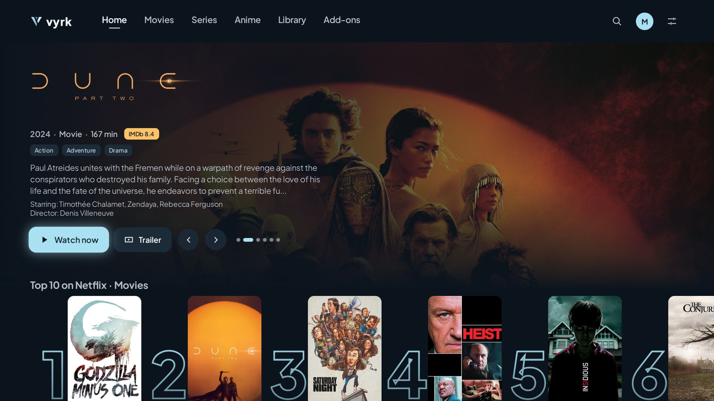<br>**Home** — featured hero with live artwork and credits | 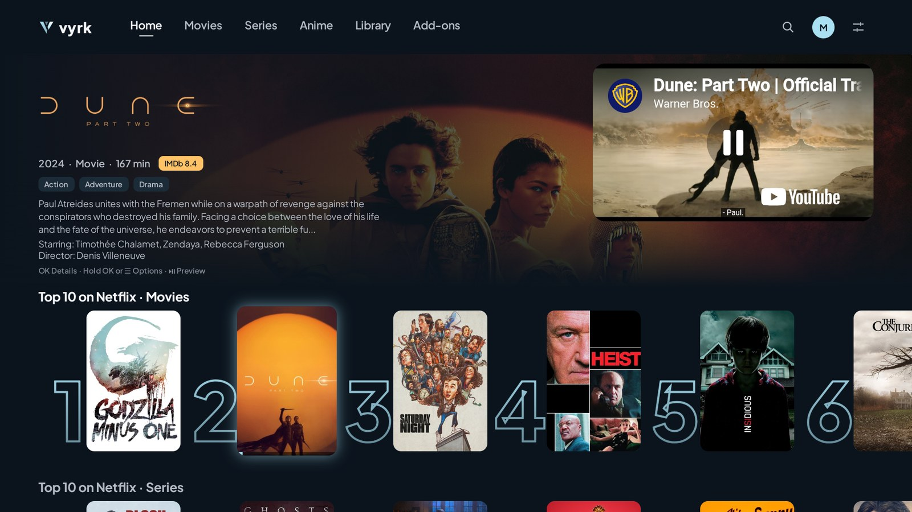<br>**Top 10 rows** — ranked per service, with the title header and a muted trailer | 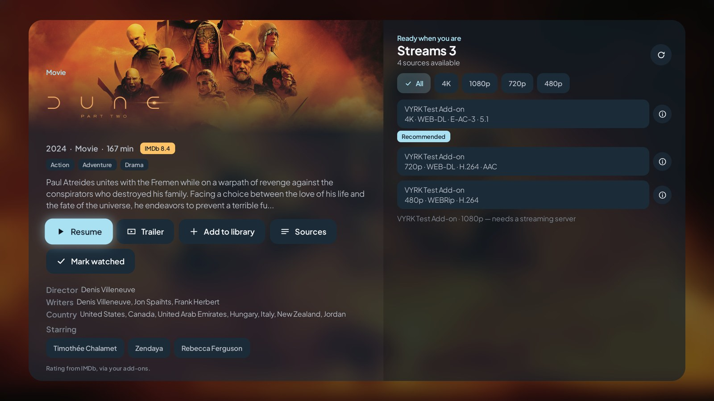<br>**Info page** — details and ranked sources side by side |
| 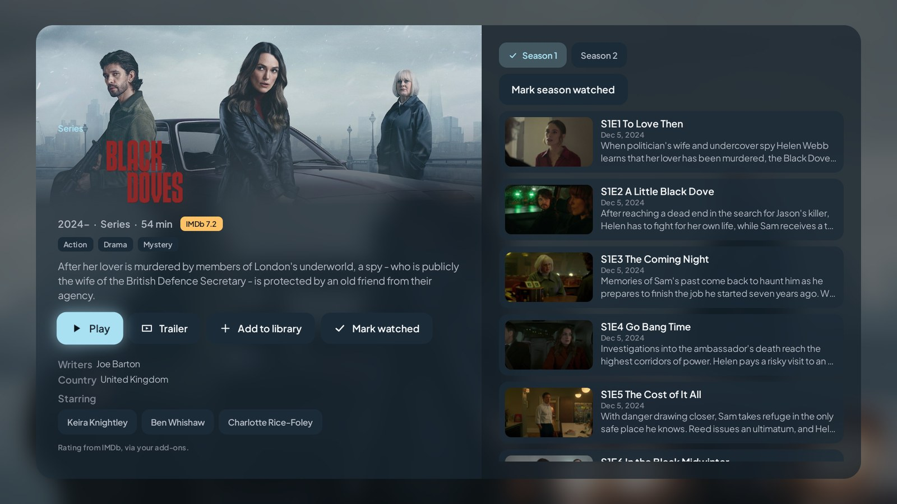<br>**Series** — season guide with stills, air dates and watched state | 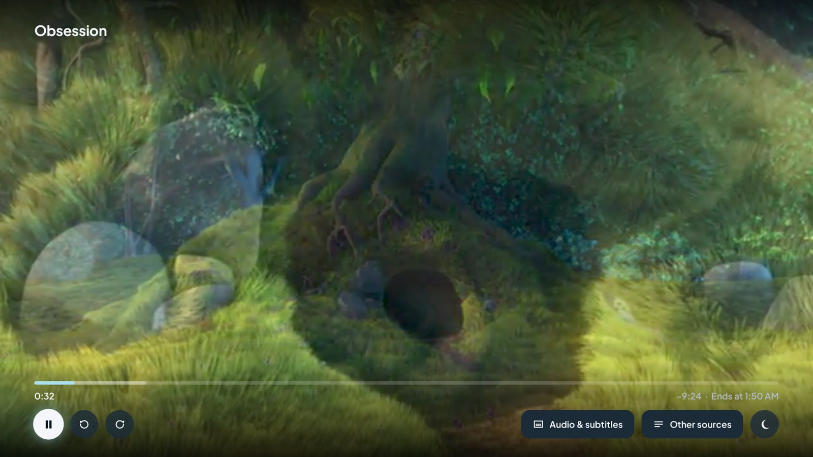<br>**Player** — elapsed, remaining and "Ends at" | 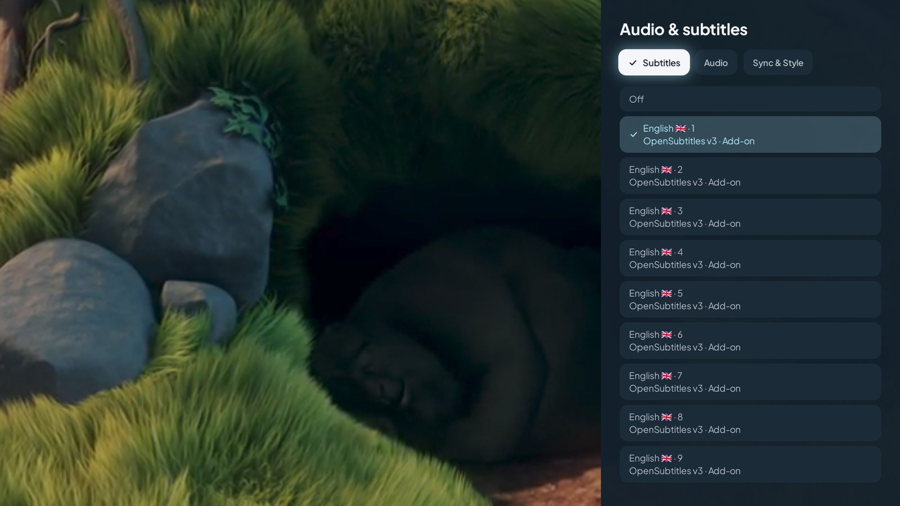<br>**Audio & subtitles** — languages as names, flags as a supplement |
| 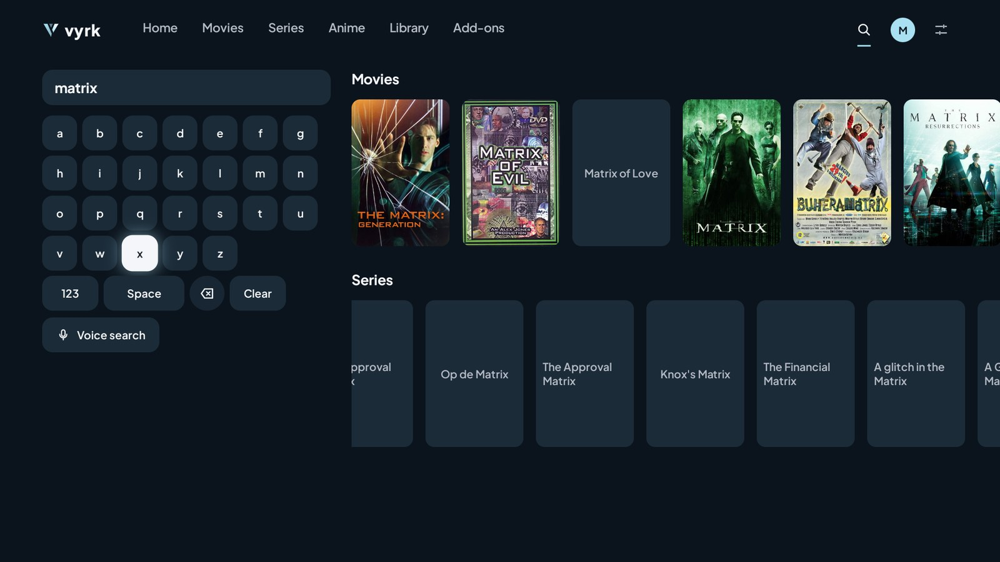<br>**Search** — on-screen keyboard, results per type | 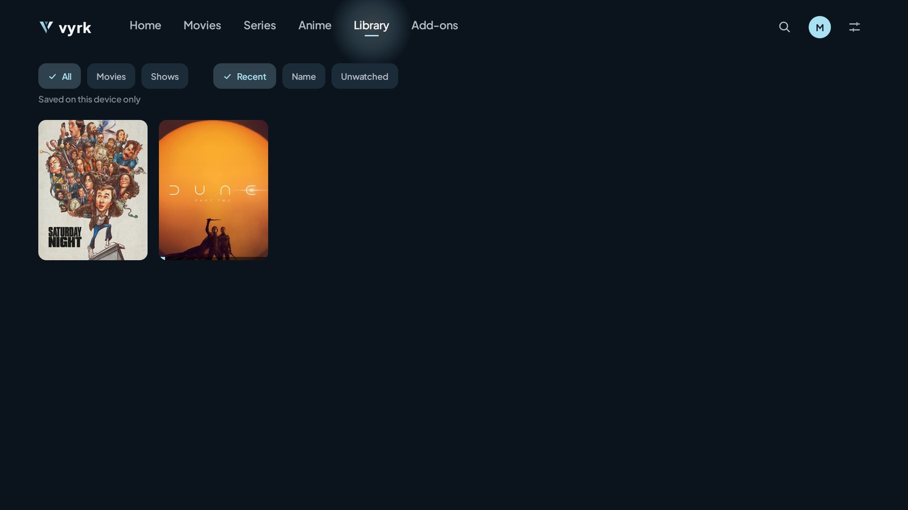<br>**Library** — filters, sorts and progress | 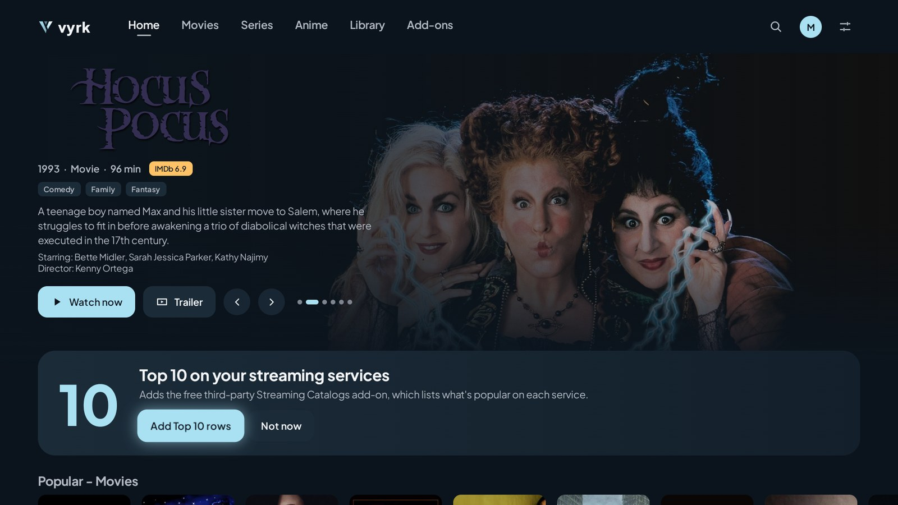<br>**Top 10 suggestion** — one press adds the rows |
| 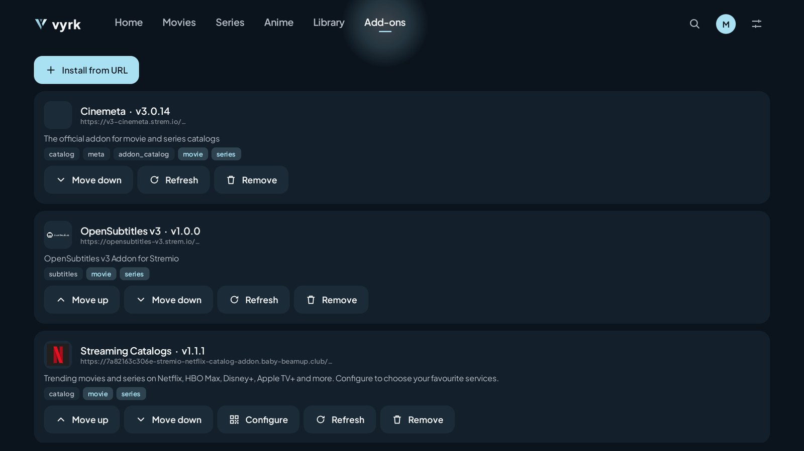<br>**Add-ons** — reorder, configure by QR, redacted URLs | 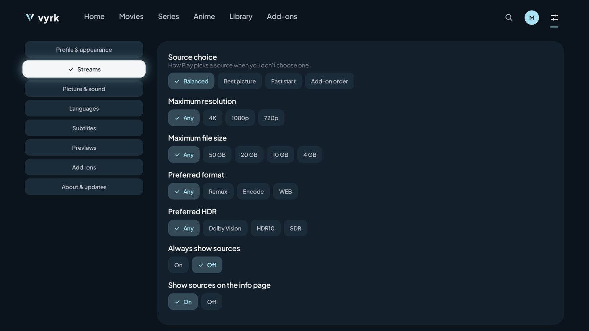<br>**Settings** — source choice and stream limits | 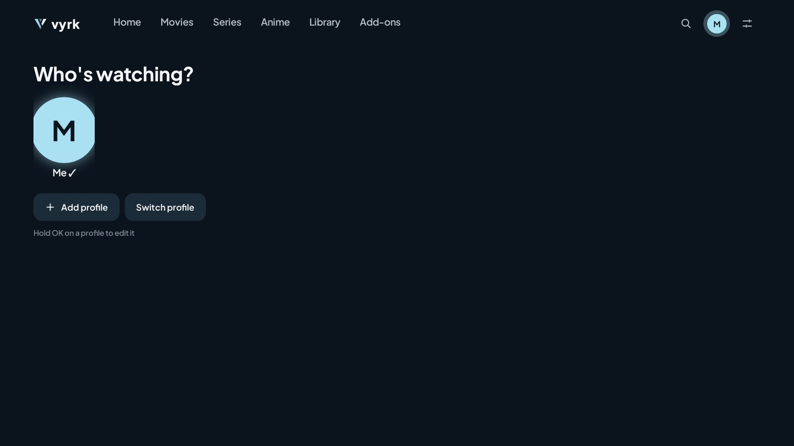<br>**Profiles** — up to five, each with its own add-ons and PIN |
| 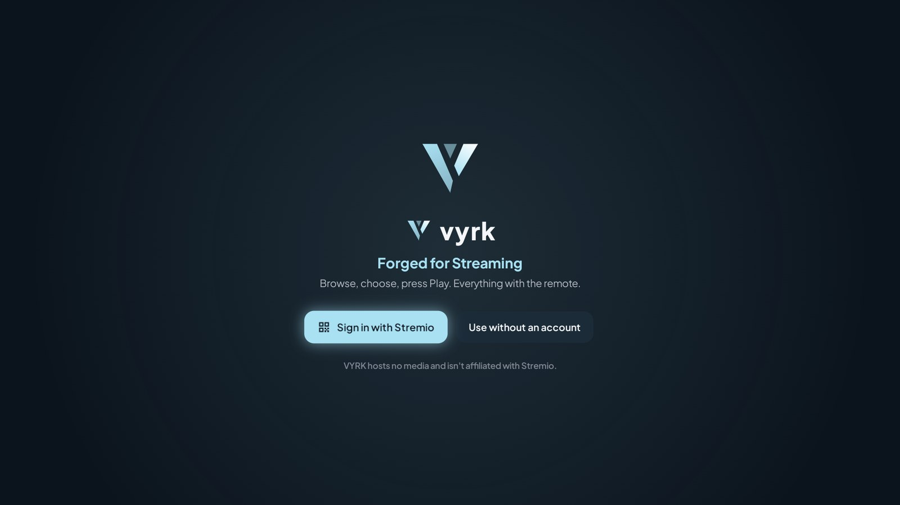<br>**First run** — sign in by QR or start without an account | | |

Screenshots are captures of the real app on an Android TV emulator with live catalogues, made by [`ci/showcase.sh`](ci/showcase.sh). Big Buck Bunny © Blender Foundation, [CC BY 3.0](https://creativecommons.org/licenses/by/3.0/). Posters, logos and artwork belong to their owners and come from the installed add-ons.

## Features

**Made for the remote** — every screen works with the D-pad, OK and Back. Focus is a soft frost glow with a slight zoom, never lost, and comes back to the exact poster after the info page, playback or a restart. The layout is fitted to a 960×540 canvas, so 1080p and 4K TVs look the same.

**Browse** — a featured hero, Continue Watching, Top 10 rows per streaming service and your catalogue rows. A title header with an optional muted trailer follows focus. Rows load lazily and page as you scroll.

**Details and sources** — a translucent info page with credits and every source ranked and explained. Play always starts the best one; choosing is optional. Series get a season guide.

**Playback** — Media3 with the FFmpeg audio decoder, HLS and DASH. Broken links are refreshed or skipped automatically; a source you picked asks before switching. Audio and subtitle preferences, subtitle sync, Up Next, sleep timers.

**Accounts, profiles and library** — Stremio sign-in by QR code, or no account at all. Up to five profiles with PINs. Watched state and Continue Watching follow Stremio's own rules, so progress reads correctly in other Stremio apps.

**Add-ons** — install from a URL, a `stremio://` link or `vyrk://install?url=…`, reorder, configure by QR on your phone, and save the list back to your account.

**TV integration** — Watch Next on the launcher, MediaSession, frame-rate matching, passthrough, in-app updates from GitHub Releases.

**Privacy** — no ads, analytics, tracking or VYRK account. Your Stremio key and add-on URLs are encrypted with an Android Keystore key and redacted everywhere they're shown or logged.

The full list, with what is verified and how, is in [docs/FEATURES.md](docs/FEATURES.md).

## Install

| APK | For |
|---|---|
| `vyrk-<version>-arm64-v8a.apk` | Most current TVs and streamers (Google TV, Shield, newer Fire TV) |
| `vyrk-<version>-armeabi-v7a.apk` | Older 32-bit devices and many Fire TV sticks |
| `vyrk-<version>-x86_64.apk` | Emulators and x86 boxes |
| `vyrk-<version>-universal.apk` | Any device, larger download |

Builds are on [Releases](https://github.com/MYKLHARU/vyrk-tv/releases). Until the first signed release, the `ci-latest` pre-release has test builds signed with a public debug key.

**With adb**

```bash
adb connect <tv-ip>:5555
```

```bash
adb install -r vyrk-<version>-arm64-v8a.apk
```

**On the TV** — install a downloader app, allow it to install unknown apps in Settings, open the APK link and install.

## Getting started

1. Open VYRK and choose **Sign in with Stremio** (scan the QR code or open the link and confirm the code) or **Use without an account**.
2. Add a stream add-on in **Add-ons › Install from URL**, or from a `stremio://` link.
3. Pick a title and press **Play**.

## Remote control

| Key | Where | Does |
|---|---|---|
| D-pad | Everywhere | Moves focus |
| OK | Poster | Opens the info page |
| OK | Hero, info page | Plays (Resume with progress) |
| Hold OK, or Menu | Hero | Opens the info page |
| Hold OK, or Menu | Poster | Opens the item menu |
| Play/Pause | Poster | Opens the preview card |
| Back | Anywhere | Closes the innermost layer; on Home, goes to the tab strip |
| Up, Down, OK | Player | Shows the controls |
| Left / Right | Player, controls hidden | Seeks −10 s / +10 s |
| Rewind / Fast-forward | Player | Seeks −30 s / +30 s |
| Next | Player | Next episode |
| CC or Audio | Player | Opens Audio & subtitles |

## Architecture

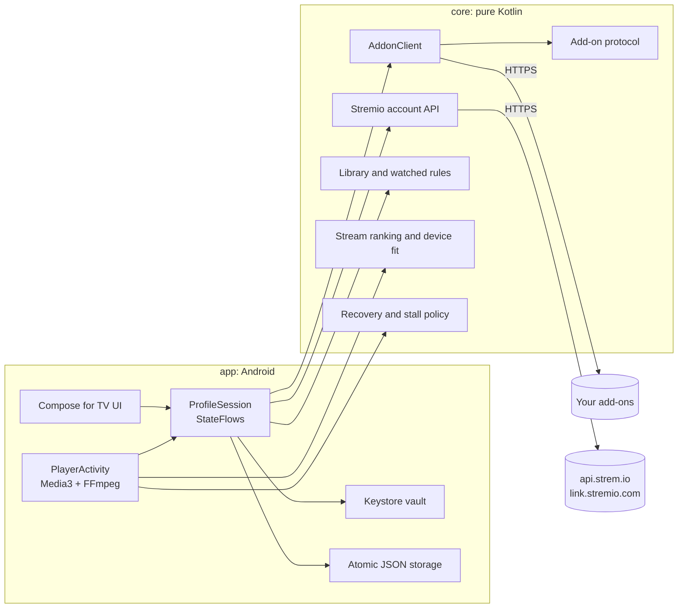

```
core/   add-on protocol and URL encoding, Stremio account API, library and watched-state rules,
        new-episode rules, stream parsing and ranking, recovery and stall policy,
        track selection, subtitle parsing, search ranking, languages, PIN hashing, update rules
app/    profiles, Keystore storage, add-on client wiring, account sync, Compose for TV UI,
        Media3 playback, device capabilities, Watch Next, in-app updater
ci/     local test add-on, emulator journey, showcase journey, shared helpers, debug signing key
docs/   feature matrix, README images and the script that builds them
i18n/   one source file per language; tools/gen_strings.py generates res/values*/strings.xml
```

## Build

Requirements: JDK 17 or newer, Android SDK with platform 37.

```bash
./gradlew :core:test :app:assembleRelease
```

APKs land in `app/build/outputs/apk/release/`.

### Branding properties

Set in `gradle.properties` or override with `-P`:

| Property | Default |
|---|---|
| `vyrk.appName` | `VYRK` |
| `vyrk.applicationId` | `com.vyrk.tv` |
| `vyrk.versionName` / `vyrk.versionCode` | `0.1.0` / `1` |
| `vyrk.updateRepo` | `MYKLHARU/vyrk-tv` (empty disables updates) |
| `vyrk.top10AddonUrl` | Streaming Catalogs manifest (empty never suggests one) |
| `vyrk.storeBuild` | `false` (`true` removes the updater and its permission) |

### Signing

Release builds read `VYRK_KEYSTORE`, `VYRK_KEYSTORE_PASSWORD`, `VYRK_KEY_ALIAS` and `VYRK_KEY_PASSWORD` from the environment. In GitHub Actions they come from the secrets `VYRK_KEYSTORE_B64` (base64 keystore), `VYRK_KEYSTORE_PASSWORD`, `VYRK_KEY_ALIAS` and `VYRK_KEY_PASSWORD`.

Without them, builds are signed with the key in [`ci/debug-signing`](ci/debug-signing). **That key is public and not secret**; it exists only so CI can produce installable test builds.

### Releases and updates

Every push to `main` publishes a `ci-latest` pre-release. Pushing a `vX.Y.Z` tag builds signed per-ABI APKs and publishes a GitHub Release, and refuses to do so without the signing secrets. The app checks `https://api.github.com/repos/<vyrk.updateRepo>/releases/latest` on launch and about every four hours (switchable), ignores pre-releases, and verifies the package name, a newer version code and the signing certificate before handing the APK to Android's installer.

## Testing

- `./gradlew :core:test` — unit tests for the add-on protocol, watched bitfield and library rules (with stremio-core's vectors), new episodes, ranking, recovery, stall detection, tracks, subtitles, search, PINs and updates.
- `python tools/gen_strings.py --check` — every language has every key, with matching placeholders.
- `ci/e2e.sh` — drives the real app on an Android TV emulator with remote keys only, against the local test add-on (`ci/test_addon.py`), and writes screenshots, a per-key focus trace and logcat.
- `ci/showcase.sh` — captures the README screenshots; `docs/tools/make_images.py` builds the images.

See [CONTRIBUTING.md](CONTRIBUTING.md) for how to run the journeys locally.

## Contributing

Issues and pull requests are welcome. Please read [CONTRIBUTING.md](CONTRIBUTING.md). Report security problems privately as described in [SECURITY.md](SECURITY.md).

## Licence

VYRK is licensed under the [GNU General Public License v3.0](LICENSE); the bundled FFmpeg audio decoder is GPLv3. Third-party notices are in [`app/src/main/res/raw/third_party_notices.txt`](app/src/main/res/raw/third_party_notices.txt) and in the app under **Settings › About & updates**.
